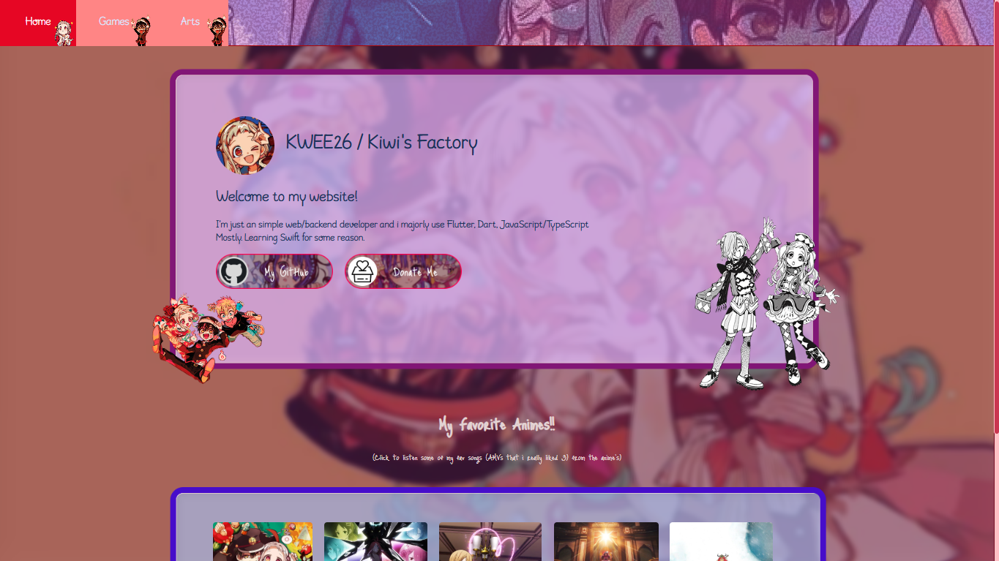

# kwe26 - Personal Website (or so i call Factory)
> An personal website made for myself with the tbhk theme-centered around!!

# Screenshot


# Want to visit the site?
<a href="https://kwee26.tech">

</a>

# Deploy myself
## What do i require?
- a computer
- a laptop
- something that could produce a a image
- Bun.sh

## YE, i have theese.!
### Install Depends
```sh
bun install
```

### Setup .env
> Create a .env file or copy .env.example into .env
```env
PORT=3000
DB=./main.db
```

### Run
```sh
bun index.ts
```

### Open!
Open http://localhost:3000 on your Computer, Yes Yours!

# References
- Toilet-bound Hanako-kun
- [Figma File](https://www.figma.com/design/3JYcKYz3sWFNoCEUShLYjO/TBHK-Themed-Website?node-id=0-1&t=PkJqUyZESzxHfXfH-1)
- Artworks from TBHK
- Project Made for [Phantom by HackClub](https://phantom.hackclub.com/home)